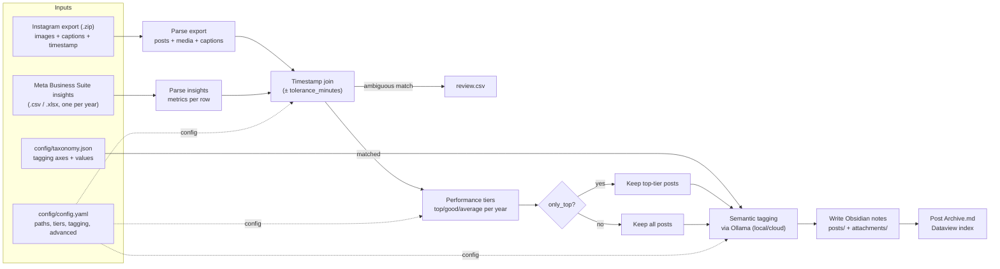

# creatorvault

**Turn your own social-media exports into a local, searchable Obsidian archive: metrics, performance tiers and local-LLM tags.**

[](https://github.com/GiulioRusso/creatorvault/actions/workflows/ci.yml)
[](pyproject.toml)
[](LICENSE)

One note per post, with its media, caption, metrics and tags, plus a Dataview index (best of each year, coverage per topic, content gaps, old posts worth reposting). It works today with the Instagram export and Meta Business Suite insights. Here is a note generated from the repo's synthetic test fixtures:

```yaml
---
date: 2024-09-15
year: 2024
time: 20:00
type: single
permalink: "https://example.com/p/p3"
tier: top
engagement: 2080
engagement_rate: 10.4
reach: 20000
saves: 300
tags:
  - post
  - program/skylab
  - angle/anecdote
  - tier/top
---

# Countdown footage from Gemini 4
```

## Why

- **Your own data.** It reads the official exports you download from Meta. No app is connected to your account.
- **No API tokens and no scraping.** Nothing logs in as you or calls Meta's API.
- **Runs locally.** Tagging uses a small model through [Ollama](https://ollama.com) on your machine. A MacBook Air with 16 GB is plenty.

The repo also holds other small creator utilities. See [Other tools](#other-tools).

## Quickstart

```bash
git clone https://github.com/GiulioRusso/creatorvault.git && cd creatorvault
python3 -m venv .venv && source .venv/bin/activate   # Windows: .venv\Scripts\activate
pip install -e '.[xlsx]'          # or: pipx install '.[xlsx]'

creatorvault init                 # writes config/config.yaml and config/taxonomy.json
# edit config/config.yaml: point it at your export and insights (see below)
creatorvault doctor               # checks everything before a long run
creatorvault build                # writes the vault
```

You need Python 3.11+. For tagging you also need Ollama:

```bash
ollama serve                      # keep running in another terminal
ollama pull llama3.2:3b           # default model, small and fast
```

`creatorvault doctor` prints a pass/fail table and exits non-zero on any failure. It checks that the export ZIP is readable and contains the posts JSON, that every insights file has a recognisable publish-time column, that the timezone is valid, that the taxonomy is valid, and (when tagging is enabled) that Ollama is reachable and the model is pulled.

## Getting your data

### 1. Instagram export (required)

From `accountscenter.instagram.com`, go to **Settings → Accounts Center → Your information and permissions → Download your information → Download or transfer information**, pick the account, then choose **Some of your information → Content**.

On the final screen:

| Option | Value | Why |
|---|---|---|
| Date range | **All time** | otherwise you lose half the archive |
| Format | **JSON** | the HTML export can't be read |
| Media quality | **High** | the best resolution Instagram will give you |

Meta takes from a few hours to a couple of days, then emails you a download link (it expires after a few days). Put the ZIP, as downloaded, anywhere (e.g. `data/ig-export/`) and point `paths.ig_export` at it. There's no need to extract it.

> **Large accounts may get an incomplete or split export.** If your notes mostly come from one period, the ZIP is probably missing media for the rest. Look for multiple parts or a separate media-only download, and add those files into the ZIP itself. Any folder inside it works, because files are also looked up by name across the whole archive.

### 2. Insights export (optional)

Without it you still get the full archive, but without metrics or tiers.

From `business.facebook.com`, go to **Insights → Content**, filter on Instagram, set the widest date range and click **Export data** (CSV or XLSX).

Meta caps this export to a short window (usually a year). Do one export per year and put them all in one folder (e.g. `data/insights/`) with any filename. Every file there is picked up automatically, and rows duplicated across overlapping exports are dropped.

The only required column is the publish time. Several header spellings (English and Italian) are recognised. If yours isn't, rename it to `Publish time`.

> **Timezone warning.** Meta Business Suite writes publish times in **Pacific Time** (`America/Los_Angeles`), whatever your account's timezone is. A wrong `advanced.insights_tz` is the #1 cause of a near-zero match rate. An unknown timezone name is a hard error, so it can't silently shift every timestamp.

## How it works



**The join.** The export and the insights share no ID, only a publish timestamp. Each insights row is matched to the post within `tolerance_minutes`. When several posts fall in the window, the row's description is compared with the captions. If that doesn't clearly pick one, nothing is guessed: the row goes to `review.csv` and the affected notes get a warning callout.

**Tiers.** Posts are ranked on `tiers.metric`, by default within each calendar year, so older posts from when the page was smaller aren't all at the bottom. The best `top_percentile`% become `top`, the rest of the top half `good`, the others `average`. Posts with no matching insights row get `no-data`.

**Tagging.** Captions (hashtags stripped) are sent in batches to Ollama with a prompt built from your taxonomy. For local models the request includes a JSON schema generated from the taxonomy, so the model can only answer with allowed values. Answers are then validated again, unknown values are dropped, and a malformed reply is retried once. Tags are cached by caption hash in `<out>/.ig_archive_cache/tags_cache.json`, so reruns only tag new or edited captions.

**Limitations, honestly.**
- The join is timestamp-based. Posts published minutes apart can be ambiguous; check `review.csv`.
- LLM tags depend on the model. Small models make mistakes; tighten `_instructions` or the value list if one keeps happening.
- The export is a snapshot. To pick up new posts, download again and rerun.

## Configuration reference

`creatorvault init` copies the commented templates. Paths are relative to the folder you run `creatorvault` from, or absolute.

### Commands

| Command | Does |
|---|---|
| `creatorvault init [--dir config]` | Copies `config.yaml` and `taxonomy.json` templates. Refuses to overwrite. |
| `creatorvault doctor [--config PATH]` | Checks config, export, insights, timezone, taxonomy and Ollama. |
| `creatorvault build [--config PATH]` | Builds the vault. Default config: `config/config.yaml`. |
| `creatorvault shop-catalog URL [...]` | See [Other tools](#other-tools). |

### `paths`

| Key | Default | Meaning |
|---|---|---|
| `ig_export` | **required** | Instagram export: a `.zip` as downloaded, or an extracted folder. |
| `insights_dir` | **required** | Folder with the insights files (`.csv`, `.tsv`, `.xlsx`, `.xlsm`). |
| `out` | **required** | Output base name. Each run writes a new `<out>-YYYYMMDD-HHMMSS/` vault. |
| `cache` | `<out>/.ig_archive_cache` | Extracted export and tag cache, reused across runs. |
| `taxonomy` | `config/taxonomy.json` | Taxonomy used for tagging. |

### `tiers`

| Key | Default | Meaning |
|---|---|---|
| `metric` | `engagement` | Any insights metric (`reach`, `impressions`, `likes`, `comments`, `shares`, `saves`, `follows`), `engagement` (likes + comments + shares + saves, unless the export has its own column) or `engagement_rate` (engagement / reach × 100, independent of page growth). |
| `top_percentile` | `25` | Share of posts in the `top` tier, per scope. |

### `tagging`

| Key | Default | Meaning |
|---|---|---|
| `model` | `llama3.2:3b` | Any pulled Ollama model, or a `-cloud` tag (needs `ollama signin`). Prefer non-reasoning models: reasoning ones (`qwen3`, `deepseek-r1`) are much slower here and can time out. |
| `enabled` | `true` | `false` skips tagging (no Ollama needed). |

### `advanced` (all optional)

| Key | Default | Meaning |
|---|---|---|
| `only_top` | `true` | Only write notes for `top` posts. Note that years without insights have no `top` posts. |
| `tolerance_minutes` | `90` | Max time difference for the join. |
| `insights_tz` | `America/Los_Angeles` | Timezone of the insights publish times (see the warning above). |
| `tier_scope` | `year` | `year` ranks within each calendar year; `global` ranks all posts together. |
| `attachments_dirname` | `attachments` | Media folder inside the vault. |
| `batch_size` | `15` | Captions per Ollama call. Lower it if a model times out. |

### Environment variables

| Variable | Default | Meaning |
|---|---|---|
| `OLLAMA_HOST` | `http://localhost:11434` | Ollama server address. |
| `OLLAMA_API_KEY` | unset | Sent as a Bearer token, only for talking to a cloud endpoint directly. |

### `taxonomy.json`

| Key | Meaning |
|---|---|
| `_instructions` | Optional prompt preamble (list of lines or one string). Keys starting with `_` are not axes. |
| any other key | One axis. Its name becomes the tag prefix (`program/apollo`). |

Each axis:

| Field | Default | Meaning |
|---|---|---|
| `values` | **required** | Closed list of allowed values. Anything else is dropped. |
| `description` | `""` | What the axis captures, shown to the model. |
| `multi` | `false` | Whether a post can have several values on this axis. |

After changing values, delete `tags_cache.json` to re-tag already-tagged posts.

## Output

```
obsidian-output-20260812-153000/   ← one fresh folder per run
├── Post Archive.md                ← Dataview index, start here
├── posts/2024-01-26-first-line-of-the-caption.md
├── attachments/2024-01-26-first-line-of-the-caption.jpg
└── review.csv                     ← only if the join left ambiguous rows
```

Open the folder as a vault in Obsidian, install the **Dataview** community plugin, and open `Post Archive.md`. Captions sit in a fenced block so their hashtags don't pollute Obsidian's tag index, and they're one click to copy for reposting. Every taxonomy axis becomes a real tag (`#program/apollo`).

## Privacy

- **Local Ollama (the default): nothing leaves your machine.** The exports, captions, metrics and the vault all stay local.
- **With a `-cloud` model, or `OLLAMA_HOST` pointed at a remote server, your captions (hashtags stripped) are sent to that server for tagging**, along with the taxonomy prompt. Metrics, media and the export itself are not sent.
- With `tagging.enabled: false`, nothing touches the network at all.

## Roadmap

- More sources behind a common `Source` interface: Facebook Page, TikTok, YouTube Takeout.

## Other tools

### Shop → Meta Commerce Manager catalog

`creatorvault shop-catalog` turns your online shop's product listing page into a CSV in the format Meta Commerce Manager expects for a Facebook/Instagram product catalog. It needs the `shop` extra:

```bash
pip install -e '.[shop]'
creatorvault shop-catalog https://app.amazecommerce.com/shop/spaceisvintage --out catalog.csv
```

| Flag | Default | Meaning |
|---|---|---|
| `shop_url` | **required** | URL of the shop's product listing page |
| `--out PATH` | `./meta_catalog.csv` | Output CSV path |
| `--brand NAME` | last path segment of `shop_url` | Used when a product page doesn't declare its own brand |
| `--currency CODE` | `USD` | ISO currency code appended to each price (`"12.99 USD"`) |

For each product linked from the listing it reads title, description, price, image, availability, condition and brand from **JSON-LD** (schema.org `Product`), then **Open Graph** tags, then the visible text as a last resort. A product that fails to parse is logged and skipped. Columns match Meta's template ([`doc/meta_catalog_products_template.csv`](doc/meta_catalog_products_template.csv)) exactly, and a test fails if they drift apart. Only these are filled in; the rest are written empty:

| Column | Source |
|---|---|
| `id` | product slug, from the URL |
| `title`, `description`, `image_link` | JSON-LD → Open Graph → visible text |
| `price` | formatted `"12.99 USD"` |
| `availability`, `condition` | Meta's values (`in stock`, `new`, ...) |
| `link` | the product page URL |
| `brand` | falls back to `--brand`, then the shop's slug |
| `gtin`, `color`, `material`, `pattern` | JSON-LD only |

Known limitation: it hasn't been run against a real shop yet. The parsing follows patterns common to most e-commerce platforms; if a field comes out wrong, open an issue with the product page's `<script type="application/ld+json">` block.

## Development

See [CONTRIBUTING.md](CONTRIBUTING.md). In short: `pip install -e '.[dev]'`, then `ruff check . && pytest --cov`. All test fixtures are synthetic, and a golden test keeps the vault output byte-for-byte stable.

## License

[MIT](LICENSE)
