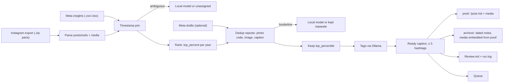

# creatorvault

**Local tools for creators on Instagram and Meta: turn your exports into an Obsidian vault and a reusable content pool, and turn your shop into a Meta product catalog.**

[](https://github.com/GiulioRusso/creatorvault/actions/workflows/ci.yml)
[](pyproject.toml)
[](LICENSE)

| Tool | Command | From | To |
|---|---|---|---|
| [**Vault**](#vault) | `creatorvault build` | Instagram export, Meta insights, Meta drafts | Obsidian vault: dated `archive/` notes with metrics, rank and tags, an undated [content pool](#content-pool), `Review.md` and `run.log` |
| [**Catalog**](#catalog) | `creatorvault catalog` | your shop's product listing page | CSV for Meta Commerce Manager (Facebook/Instagram shop) |
| [Queue](#queue) | `creatorvault queue` | the vault's contents | images + ready captions for the next posting slots |

Everything runs on your machine: no app is connected to your account and no Meta API is called. Tagging and doubt resolution use a small model through [Ollama](https://ollama.com), locally.

## Install and configure

Python 3.11+.

```bash
python3 -m venv .venv
.venv/bin/python -m pip install '.[xlsx,dedup,shop]'
.venv/bin/creatorvault init          # writes config/config.yaml; refuses to overwrite
```

**The config file is the only entry point.** Every option, for every tool, lives in `config/config.yaml`; commands take nothing but `--config` (default `config/config.yaml`); `drafts-script` takes nothing at all:

```bash
creatorvault doctor  --config config/config.yaml   # PASS/WARN/FAIL for each input
creatorvault build   --config config/config.yaml   # vault: archive + pool
creatorvault queue   --config config/config.yaml   # next posting slots
creatorvault catalog --config config/config.yaml   # shop -> Meta catalog CSV
creatorvault drafts-script | pbcopy                # browser script: Business Suite drafts -> zip
```

Options that are unknown or were removed fail with a message naming the replacement, so a typo never silently falls back to a default. Relative paths resolve from the folder you run the command in. [config/example.yaml](config/example.yaml) is a shareable starting point; the personal `config/config.yaml` is ignored by Git. Commands below use `creatorvault` for brevity: prefix it with `.venv/bin/` or activate the environment.

---

## Vault

One note per **unique content**, even when it went out several times: media, a caption ready to repost with at most 5 hashtags, metrics, its performance rank, semantic tags and every publication.

### What you get

```
vault/                             ← rebuilt in place (see advanced.timestamped_out)
├── Review.md                      ← start here: summary, model decisions, drafts, untagged, Dataview queries
├── run.log                        ← this run's log; first lines: date and the command to rerun it
├── archive/2024-01-26-first-line-of-the-caption.md   ← dated, metrics, publications
└── pool/first-line-of-the-caption/{post.md,01.jpg}   ← undated, see Content pool
```

Nothing else is written in the vault: no database, CSV or cache. The extracted export is temporary; the model's answers (tags, review decisions) are cached in `.creatorvault-cache/` next to the vault, so a rerun only asks about new captions. `archive/` belongs to the build: notes no longer generated are removed there. Your own notes elsewhere in the vault are never touched.

Prepared descriptions sit in fenced blocks, so their hashtags don't pollute Obsidian's tag index, and they're one click to copy. Every taxonomy axis becomes a real tag (`#program/apollo`).

A dated note in `archive/`, generated from the repo's synthetic fixtures:

```yaml
---
date: 2024-11-20
year: 2024
time: 17:00
type: single
permalink: "https://example.com/p/p4"
top_percent: 86
pool: "[[pool/lequipaggio-e-tornato-a-casa/post]]"
status: published
times_published: 1
first_published: 2024-11-20
last_published: 2024-11-20
published: [2024-11-20]
best_engagement: 167
engagement: 167
engagement_rate: 3.34
reach: 5000
tags:
  - post
  - program/apollo
  - angle/quote
---

# L'equipaggio è tornato a casa 🚀
```

### Quickstart

1. Download your data ([below](#getting-your-data)) into `data/`.
2. Point the config at it:

   ```yaml
   paths:
     ig_export: data/ig-export/instagram-yourpage.zip   # or a list of ZIP parts
     insights_dir: data/insights                        # optional
     out: vault
   selection:
     metric: engagement_rate
     top_percentile: 100        # 100 = every content; 25 = only the best 25%
   ```

3. To tag captions, start Ollama and pull the model once: `ollama serve`, `ollama pull llama3.2:3b`. Without Ollama the build still runs, without tags (unless `tagging.required: true`).
4. `creatorvault build`, then open `vault/` in Obsidian (install the **Dataview** community plugin) and start from `Review.md`.

Rerun the same command after every new export: the vault is rebuilt in place. The exact command is also on the second line of `run.log`.

### Choosing what to keep: one percentile

`selection.top_percentile` is the only filter. Each publication gets `top_percent: N`, meaning it is in the best N% on `selection.metric`, ranked per calendar year (`scope: year`, so older posts from when the page was smaller aren't all at the bottom) or over the whole archive (`scope: global`). A content takes the rank of its best publication.

| `top_percentile` | Notes written |
|---|---|
| `100` (default) | every content: also posts without matching insights and never-published drafts |
| `25` | only contents ranked in the best 25%; contents without metrics are left out |

`top_percent` is `ceil(100 × (posts strictly better + 1) / posts ranked)`: the best of 4 posts is `25`, ties share the better rank. In a group of 3, the best post is `34`, so a `25` threshold keeps none of them. With no insights at all, only `100` produces notes.

### No manual review

Duplicates and ambiguous insight joins are settled automatically, so the vault holds unique posts with nothing for you to check:

- **Clear cases** follow rules: same NASA photo code, same image, or caption similarity ≥ `dedup.caption_same` merge; two different photo codes never merge.
- **Borderline cases** (similarity between `caption_maybe` and `caption_same`, or several posts in an insights row's time window) go to the **local model** when `review.enabled: true`. It applies a decision only at `review.min_confidence` or above.
- **Otherwise** the conservative outcome applies: the two contents stay separate, the metrics stay unassigned. If Ollama is unavailable, the build warns and does the same (or stops, with `tagging.required: true`).

The model's decisions are listed in `Review.md` (case, reference, outcome, confidence, reason). Explicit `merge` / `split` lists in `config/dedup_overrides.yaml` always win (see [How it works](#how-it-works)).

### Getting your data

#### 1. Instagram export (required)

From `accountscenter.instagram.com`, go to **Settings → Accounts Center → Your information and permissions → Download your information → Download or transfer information**, pick the account, then choose **Some of your information → Content**.

On the final screen:

| Option | Value | Why |
|---|---|---|
| Date range | **All time** | otherwise you lose half the archive |
| Format | **JSON** | the HTML export can't be read |
| Media quality | **High** | the best resolution Instagram will give you |

Meta takes from a few hours to a couple of days, then emails you a download link (it expires after a few days). Put the ZIP, as downloaded, anywhere (e.g. `data/ig-export/`) and point `paths.ig_export` at it. There's no need to extract it.

#### Split downloads: keep the parts separate

If Instagram provides two ZIPs, keep both unchanged and list them in the same config:

```yaml
paths:
  ig_export:
    - data/ig-export/part1.zip
    - data/ig-export/part2.zip
  out: vault
```

Both ZIPs are extracted into a temporary folder that is deleted when the run ends, and post metadata and media are read across parts. Repeated metadata is imported once even with deduplication disabled. Every selected numbered `posts_1.json`, `posts_2.json`, etc., and/or `reels.json` is read. At least one part must contain metadata for a selected content type; the other parts can contain only media.

Matching uses the relative path across the ZIP parts before falling back to filenames. Identical copies are accepted; ambiguous matches with different file contents stop with an error so a post does not get the wrong photo.

#### 2. Insights export (optional)

Without insights you still get every post (with `selection.top_percentile: 100`), without metrics or ranks.

From `business.facebook.com`, go to **Insights → Content**, filter on Instagram, set the widest date range and click **Export data** (CSV or XLSX).

Use Instagram exports for the Instagram archive. Slash-separated dates are interpreted consistently per file using unambiguous dates (for example, `08/25/2026` identifies month/day order). CSV captions may contain escaped quotes and multiple lines.

Meta caps this export to a short window (usually a year). Do one export per year and put them all in one folder (e.g. `data/insights/`) with any filename. Every file there is picked up automatically, and rows duplicated across overlapping exports are dropped.

The only required column is the publish time. Several header spellings (English and Italian) are recognised. If yours isn't, rename it to `Publish time`.

> **Timezone warning.** Meta Business Suite writes publish times in **Pacific Time** (`America/Los_Angeles`), whatever your account's timezone is. A wrong `advanced.insights_tz` is the #1 cause of a near-zero match rate. An unknown timezone name is a hard error, so it can't silently shift every timestamp.

#### 3. Meta drafts (optional)

Business Suite has no export for drafts, so CreatorVault ships a small browser script that does it:

1. In Business Suite open **Content → Posts & reels → Drafts**, set the date filter, and scroll the list to the bottom (rows only load while you scroll).
2. Copy the script: `creatorvault drafts-script | pbcopy` (macOS; elsewhere, copy what it prints).
3. Open the Chrome console (`Cmd+Option+J` / `Ctrl+Shift+J`; the first time Chrome asks you to type `allow pasting`), paste and press Enter.

It opens each loaded draft's editor in a hidden frame (nothing is saved), reads the full caption and the full-size media, and downloads one `meta-drafts-YYYYMMDD-HHMM.zip`. Put the zip, as downloaded, in `data/meta-drafts/` (`paths.meta_drafts`) and run `creatorvault build`. Settings at the top of the script: `periods` (keep only drafts created in date ranges), `limit` (e.g. `3` for a first test) and `dryRun` (list in the console, no download). The script relies on Business Suite's page structure and may need an update when Meta changes it.

The folder can hold several zips (one per period, or overlapping exports) and a hand-made `drafts.json` with the images next to it, in the same format as the one inside the zips:

```json
[
  {
    "id": "531138529578816",
    "caption": "Jul. 20, 1969: ...",
    "media": ["531138529578816.jpg"],
    "updated": "2024-08-22",
    "platforms": ["facebook", "instagram"]
  }
]
```

The same draft id in more than one file counts once: the entry with the latest `updated` wins.

| Field | Required | Meaning |
|---|---|---|
| `id` | yes | Draft id from Business Suite. Entries without one are skipped. |
| `updated` | yes | Last edit, `YYYY-MM-DD` (or a full ISO timestamp). Used as the draft's date. |
| `caption` | no | Draft text. |
| `media` | no | Filenames next to `drafts.json` (or inside the same zip). A draft without an image still gets a note, without an embed. |
| `platforms` | no | Informational. |
| `content_type` | no | `posts` (default) or `reels`; used by `content_types` selection. |

Drafts go through deduplication with the published posts: a draft of a published post makes that note `status: published+draft` (a potential repost), a draft never published becomes a `status: draft` note, and several drafts of the same content become one note listing all their `draft_ids`. The **Meta drafts** table in `Review.md` has one row per draft with its note, status and `duplicate_of`: the drafts with a `duplicate_of` pointing to another draft are the redundant ones to delete in Business Suite.


### Content pool

Every build writes `<out>/pool/`, an **undated** copy of the selected contents: a stock of posts to reuse, not a history. One folder per content, readable as plain files. The media live only here: the dated `archive/` notes embed them from the pool.

```
vault/pool/
├── jul-20-1969-buzz-aldrins-bootprint/
│   ├── post.md
│   ├── 01.jpg
│   └── 02.jpg
└── voyager-1-golden-record/
    ├── post.md
    └── 01.jpg
```

```markdown
---
id: 4f1c2a9be03d
origin: archive
content_type: posts
format: carousel
media: [01.jpg, 02.jpg]
top_percent: 12
tags:
  - program/apollo
  - subject/lunar-surface
---

# Jul. 20, 1969: Buzz Aldrin's bootprint


## Description

(the ready caption, in a text block: story + at most 5 hashtags)
```

There is no publication date in folder names, filenames or frontmatter; historical dates in the story stay. Folders are named after the caption's first line (`-2`, `-3` on collisions). The pool is rebuilt in place: folders with `origin: archive` belong to the build (updated, or removed when no longer selected); posts you add by hand say `origin: manual` and are never touched.

To add **new** posts by hand (or with an assistant), create a folder in the same format with `origin: manual` in the frontmatter, tags from the config's `taxonomy` and at most `hashtags.max` hashtags from `hashtags.pool`.

### Queue

```bash
creatorvault queue --config config/config.yaml
```

Reads the `queue:` section (`next`, `start`, `days`, `time`, `min_repost_months`, `out`), runs the same pipeline as `build` (using the caches), then picks never-published drafts first (oldest first), then published contents not out for `min_repost_months`, best `top_percent` first, avoiding two in a row with the same value on the first taxonomy axis. Contents without an image are skipped. It replaces the previous queue's files in `queue/`:

```
queue/
├── 01-2026-11-30-first-line-of-the-caption.jpg
├── 01-2026-11-30-first-line-of-the-caption.txt   ← ready caption, ≤ 5 hashtags
└── queue.csv                                      ← date, time, image, caption, note
```

Nothing is published: upload the files to Buffer or Business Suite yourself.

### How it works



**The join.** The export and the insights share no ID, only a publish timestamp. Each insights row is matched to the post within `advanced.tolerance_minutes`; when several posts fall in the window, the row's description is compared with the captions. What is still ambiguous goes to the local model, which can only pick among same-type, unassigned publications within 24 hours and never invents metrics; otherwise the metrics stay unassigned.

**Deduplication.** The same content often goes out several times with a slightly different caption. Publications are grouped with three signals, strongest first:

1. **NASA photo code** in the caption (`AS11-40-5903`, `S69-31739`, `GT4-...`, `STS...`, `ISS...-E-...`; the regexes are configurable). Same code = same content, zero-padding ignored (`AS14-66-09302` = `AS14-66-9302`). Two *different* codes are never merged, however similar the captions are.
2. **Image fingerprint**: a 64-bit dHash of the first image, matched within `dedup.image_distance` bits. Needs the `dedup` extra (Pillow); without it this signal is skipped with a warning. Videos are skipped.
3. **Caption similarity**: `SequenceMatcher` ratio of the captions after dropping hashtags, mentions, URLs, emoji, punctuation and boilerplate lines (`check link in bio...`, lines of dots). ≥ `caption_same` (0.85) merges; between `caption_maybe` (0.70) and 0.85 goes to the local model, and stays separate without one. Calibrated on a real 2k-post archive, using same/different NASA codes as ground truth: at 0.85 no false merge, while below 0.60 any two captions on the same topic look alike (so it's the minimum). Pairs sharing under 30% of their words are skipped, and only captions mentioning the same first year (or none) are compared, which keeps a 2k-post archive to seconds.

Optional explicit overrides in `config/dedup_overrides.yaml` take precedence over the local model and are read on every build. Each entry is a permalink, a Meta draft id, or a date/timestamp prefix (UTC, as in the note filenames):

```yaml
merge:
  - ["https://www.instagram.com/p/AAA/", "2023-05-01"]
split:
  - ["https://www.instagram.com/p/BBB/", "https://www.instagram.com/p/CCC/"]
```

The merged note is named after the **first** publication (so it doesn't move between builds) and lists every publication in a table. Its frontmatter has `times_published`, `first_published`, `last_published`, `published`, `photo_ids`, `best_engagement`, `status`, and the best publication's `top_percent` and metrics; reposts get the `repost/yes` tag.

**Hashtags.** Instagram rejects scheduled posts with too many hashtags, so every note has one **Description** block: the caption without its hashtags (inline ones become plain words, trailing `.` spacer lines go), a `.` line, then at most `hashtags.max` (≤ 5) hashtags picked by `hashtags.strategy`:

| Strategy | Hashtags used |
|---|---|
| `fixed` (default) | `hashtags.fixed` |
| `keep_original` | the first `max` of the post's own hashtags |
| `pool` | `max` unique hashtags sampled from `hashtags.pool`, ignoring the original ones; stable for the same caption |
| `taxonomy` | `hashtags.taxonomy` mapped from the post's tags (`program/apollo: "#apollo"`), topped up with `fixed` |

**Tagging.** Captions (hashtags stripped) are sent in batches to Ollama with a prompt built from your taxonomy. For local models the request includes a JSON schema generated from the taxonomy, so the model can only answer with allowed values. Answers are then validated again, unknown values are dropped, and a malformed reply is retried once. Tags are cached by caption hash in `.creatorvault-cache/tags_cache-<settings-hash>.json` (next to the vault, never inside it), so reruns only tag new or edited captions.

### Limitations

- Model confidence is self-reported, not a calibrated probability. NASA-code conflicts and `split` overrides can't be overridden by the model.
- Image matching uses the first image only: carousels sharing an opening image can merge; use a `split` override.
- LLM tags depend on the model; small models make mistakes. Tags use the caption text, not the image.
- `content_types` reads numbered `posts_*.json` and `reels.json`; stories, archived posts and the newer `posts.json` schema are not imported.
- `archive/` belongs to the build: keep your own notes elsewhere in the vault (or in `pool/` with `origin: manual`).

---

## Catalog

`creatorvault catalog` turns your online shop's product listing page into a CSV in the format Meta Commerce Manager expects for a Facebook/Instagram product catalog. It needs the `shop` extra (`pip install '.[shop]'`) and the `catalog:` section of the config:

```yaml
catalog:
  shop_url: https://example.com/shop   # required: the product listing page
  out: meta_catalog.csv
  brand: Your Brand                    # default: last path segment of shop_url
  currency: USD                        # appended to each price: "12.99 USD"
```

```bash
creatorvault catalog --config config/config.yaml
```

For each product linked from the listing it reads title, description, price, image, availability, condition and brand from **JSON-LD** (schema.org `Product`), then **Open Graph** tags, then the visible text as a last resort. A product that fails to parse is logged and skipped. Columns match Meta's template ([`doc/meta_catalog_products_template.csv`](doc/meta_catalog_products_template.csv)) exactly, and a test fails if they drift apart. Only these are filled in; the rest are written empty:

| Column | Source |
|---|---|
| `id` | product slug, from the URL |
| `title`, `description`, `image_link` | JSON-LD → Open Graph → visible text |
| `price` | formatted `"12.99 USD"` |
| `availability`, `condition` | Meta's values (`in stock`, `new`, ...) |
| `link` | the product page URL |
| `brand` | falls back to `catalog.brand`, then the shop's slug |
| `gtin`, `color`, `material`, `pattern` | JSON-LD only |

Known limitation: it hasn't been run against a real shop yet. The parsing follows patterns common to most e-commerce platforms; if a field comes out wrong, open an issue with the product page's `<script type="application/ld+json">` block.

---

## Configuration reference

### `paths`

| Key | Default | Meaning |
|---|---|---|
| `ig_export` | **required** | Instagram export: a `.zip` as downloaded, a list of ZIP parts, or an extracted folder. |
| `insights_dir` | `data/insights` | Insights files (`.csv`, `.tsv`, `.xlsx`, `.xlsm`). Missing or empty = no metrics. |
| `meta_drafts` | `data/meta-drafts` | Folder with the draft exports (`*.zip` from `creatorvault drafts-script`) and/or `drafts.json` with the draft images. Used only if it exists. |
| `out` | `vault` | Output vault. |
| `cache` | `.creatorvault-cache` next to `out` | Tag and review caches (model answers). Must be outside `out`; shared by configs in the same folder. |

### `content_types`

`[posts]` (default), `[reels]` or `[posts, reels]`. For separate post and reel vaults, use two configs that differ only in `content_types` and `paths.out` (e.g. `config/config.yaml` → `vault-posts`, `config/config-reels.yaml` → `vault-reels`) and run `build` once per config; both share `.creatorvault-cache/`. The type comes from Instagram's metadata, not the file extension: a feed video is a post. Reel notes get `content_types: [reels]` and a `reel` tag. Drafts may set `"content_type": "reels"`; untyped drafts are posts.

### `selection`

| Key | Default | Meaning |
|---|---|---|
| `metric` | `engagement_rate` | Any insights metric (`reach`, `likes`, `comments`, `shares`, `saves`, `follows`...), `engagement` (likes + comments + shares + saves, unless the export has its own column) or `engagement_rate` (engagement / reach × 100). |
| `top_percentile` | `100` | Keep contents ranked in the best N%. `100` keeps everything. |
| `scope` | `year` | `year` ranks within each calendar year; `global` over the whole archive. |

### `dedup`

| Key | Default | Meaning |
|---|---|---|
| `enabled` | `true` | `false` = one note per publication. |
| `caption_same` | `0.85` | Caption similarity (0–1, inclusive) that merges automatically. |
| `caption_maybe` | `0.70` | From here up to `caption_same`: the local model decides; kept separate without one. Minimum `0.60`. |
| `image_distance` | `6` | Max differing bits (of 64) between two image fingerprints. |
| `photo_id_patterns` | NASA codes | Regexes for photo codes. |
| `boilerplate` | `check link in bio`, lines of dots | Full-line regexes ignored when comparing captions. |
| `overrides` | `config/dedup_overrides.yaml` | Manual `merge` / `split` lists. |

### `tagging` and `review`

| Key | Default | Meaning |
|---|---|---|
| `tagging.enabled` | `true` | `false` skips tagging. |
| `tagging.model` | `llama3.2:3b` | Any pulled Ollama model, or a `-cloud` tag (needs `ollama signin`). Reasoning models run with thinking off; `qwen3:8b` is a good pick on a 16 GB machine (about 1–2 minutes per batch). |
| `tagging.required` | `false` | Stop when tagging or the local review can't run, instead of warning. |
| `review.enabled` | `false` (`true` in the template) | Let a local model settle borderline duplicates and joins. |
| `review.model` | `tagging.model` | Must be local: cloud models and non-loopback `OLLAMA_HOST` are rejected. |
| `review.min_confidence` | `0.85` | Below this, the conservative outcome applies. |

### `taxonomy`

Category names with their allowed labels, e.g. `program: [apollo, gemini]` → tags like `program/apollo`. Lists allow several labels; `{values: [...], multi: false}` allows one. Changing the taxonomy or model uses a fresh tagging cache.

#### Advanced taxonomy format (optional)

The `taxonomy` block normally uses category lists, as shown in the Quickstart. To add descriptions or control multiple labels, use the mappings below inside the same YAML.

| Key | Meaning |
|---|---|
| `_instructions` | Optional prompt preamble (list of lines or one string). Keys starting with `_` are not axes. |
| any other key | One axis. Its name becomes the tag prefix (`program/apollo`). |

Each axis:

| Field | Default | Meaning |
|---|---|---|
| `values` | **required** | Closed list of allowed values. Anything else is dropped. |
| `description` | `""` | What the axis captures, shown to the model. |
| `multi` | `false` | Whether a post can have several values on this axis. |

Changing the model or taxonomy automatically selects a fresh cache; no manual cache deletion is needed.

### `hashtags`

| Key | Default | Meaning |
|---|---|---|
| `max` | `5` | Max hashtags in the ready caption, 0 to 5. |
| `strategy` | `fixed` | `pool`, `fixed`, `keep_original` or `taxonomy`. |
| `pool` | the `fixed` defaults | Topic pool sampled by `pool`. |
| `fixed` | `#history #space #moon #exploration #science` | Used by `fixed`, and to top up `taxonomy`. |
| `taxonomy` | `{}` | Tag → hashtag map, e.g. `program/apollo: "#apollo"`. |

### `queue`

| Key | Default | Meaning |
|---|---|---|
| `next` | `10` | How many posts to prepare. |
| `start` | tomorrow | First slot, `YYYY-MM-DD`. |
| `days` | `[mon, wed, thu, sat, sun]` | Posting days. |
| `time` | `"19:30"` | Posting time written to `queue.csv`. |
| `min_repost_months` | `12` | A published content is a repost candidate once it hasn't been out this long. |
| `out` | `queue` | Output folder. |

### `catalog`

See [Catalog](#catalog): `shop_url` (required), `out`, `brand`, `currency`.

### `advanced` (all optional)

| Key | Default | Meaning |
|---|---|---|
| `timestamped_out` | `false` | `true` writes a new `<out>-YYYYMMDD-HHMMSS/` folder per run instead of rebuilding in place. |
| `tolerance_minutes` | `90` | Max time difference for the insights join. |
| `insights_tz` | `America/Los_Angeles` | Timezone of the insights publish times. |
| `batch_size` | `15` | Captions per Ollama call. Lower it if a model times out. |

### Environment variables

| Variable | Default | Meaning |
|---|---|---|
| `OLLAMA_HOST` | `http://localhost:11434` | Ollama server address. |
| `OLLAMA_API_KEY` | unset | Bearer token, only for a cloud endpoint. |

## Privacy

- **Local Ollama (the default): nothing leaves your machine.** Exports, captions, metrics, vault and pool stay local.
- **With a `-cloud` tagging model, or a remote `OLLAMA_HOST`, captions (hashtags stripped) are sent to that server for tagging.** Metrics and media are not. The local review never uses a remote model.
- The catalog fetches your shop's public pages, and nothing else.

## Development

See [CONTRIBUTING.md](CONTRIBUTING.md). In short: `pip install -e '.[dev]'`, then `ruff check . && ruff format --check . && pytest --cov`. All test fixtures are synthetic, and a golden test keeps the vault output byte-for-byte stable (`python tests/make_golden.py` regenerates it on purpose).

## License

[MIT](LICENSE)
